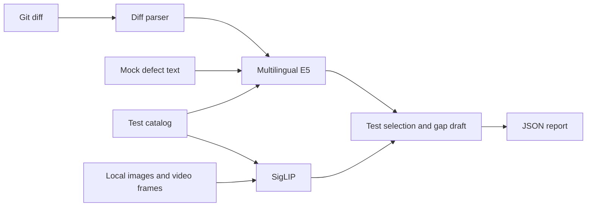

# E5 Diff-to-Test Planner

A prototype for selecting automotive infotainment regression tests from Git
changes and mock defect descriptions. It uses multilingual E5 text embeddings
and optionally compares local screenshot and video evidence with SigLIP.

> **Not a safety or production decision tool.** Similarity is not a probability
> of failure or coverage; review selections and retain mandatory regression.
> Time savings are estimates. Version/release recommendations are illustrative
> heuristics, not verified compatibility data. An 80% reduction against a
> hypothetical 4,000-test suite is a target, not a measured result.



## Local setup

Requires Python 3.11+ and, for video, `ffmpeg` and `ffprobe` on PATH (on macOS:
`brew install ffmpeg`). Run from this repository:

```bash
bash setup.sh
source .venv/bin/activate
python -m pytest tests/ -q
```

Setup reuses `.venv`, initializes SQLite databases under `data/db/`, and adds
sample records without replacing existing ones. In interactive zsh, avoid
pasting lines beginning with `#` unless `interactivecomments` is enabled.

## Analyze text

```bash
python -m src.cli analyze --diff data/sample_pr_diff.patch --defect data/sample_jira_defect.json --catalog data/sample_test_catalog.json --output report.json
```

For a quick, deterministic smoke test add `--mock-embeddings`; the mock is not
an AI model and its scores are not suitable for test-selection decisions.
To compare local Git commits:

```bash
python -m src.cli analyze --git-repo /path/to/repository --git-base HEAD~1 --git-head HEAD --catalog data/sample_test_catalog.json --output report.json
```

The default catalog includes climate, parking, phone, media, navigation,
charging and display scenarios. Try `data/climate_temperature.patch`,
`data/media_audio_focus.patch`, and `data/parking_camera.patch`.

## Images and videos

Try a synthetic defect video and sample test screenshots:

```bash
python -m src.cli analyze --defect data/sample_media_defect.json --catalog data/sample_media_catalog.json --output media-report.json
```

For local mock Jira data, add an `attachments` array of local path strings to
the defect and applicable catalog tests. Paths are relative to the containing
JSON file. Or add `--media /path/to/screenshot.png` to a diff, Git, or defect
analysis. A Git revision comparison reads supported added or modified media
from the head commit; Git LFS pointers require the downloaded file via `--media`.
Patch files do not contain usable binary media.

Supported images: PNG, JPEG, WebP and BMP. Supported video: MP4, MOV, MKV and
WebM, up to 100 MiB and 10 minutes per file. Five video frames are sampled.
Audio, OCR, motion analysis, remote attachment URLs and Jira connections are
not supported. The highest image-to-image similarity and its matching frames are
reported separately from text similarity; `--visual-threshold` can include a
visually matching test. Models cannot prove visual correctness, read all text,
or detect events between sampled frames. Tune thresholds using labeled data.

Text uses [multilingual E5 base](https://huggingface.co/intfloat/multilingual-e5-base)
(MIT); images use [SigLIP base](https://huggingface.co/google/siglip-base-patch16-224)
(Apache-2.0). Both execute locally for the CLI and may download weights on first
use. Once cached, set `HF_HUB_OFFLINE=1` to prevent network access. Evidence is
not sent to the model provider. `--mock-embeddings` affects text only.

## GitHub Pages and Google Sites

The static frontend is designed for
`https://ankita-sathya.github.io/e5-diff-to-test-planner/`. GitHub Pages cannot
run Python; the page needs a separately running HTTPS analysis server before
its Analyze button can work. The scenario dropdown previews three illustrative
reports without a server; their scores and timings are invented examples, not
model predictions or measured savings. Threshold sliders apply only to live
analysis. Image/video analysis is currently CLI-only.

1. In GitHub, open repository **Settings → Pages** and select **GitHub Actions**
   as the source if it is not already enabled. The workflow builds and deploys
   the static frontend on pushes to `main`.
2. Deploy the backend as described below, then enter its HTTPS URL in the
   dashboard's **Analysis server URL** field.
3. In Google Sites, add a button linking to the Pages URL. Alternatively use
   **Insert → Embed → By URL**; if embedding is blocked, use the button link.

### Set up your own backend

On a machine or service you control, install Python 3.11+, clone this
repository, install `requirements.txt` in a virtual environment and run:

```bash
python -m uvicorn src.api:app --host 127.0.0.1 --port 8000
```

Put it behind an HTTPS reverse proxy and give the dashboard the proxy's URL.
The default allowed browser origins are `https://ankita-sathya.github.io` and
`http://localhost:3000`; set `E5_ALLOWED_ORIGINS` to a comma-separated list to
change them. The backend loads E5 and the sample catalog on the first analysis;
allow adequate RAM, disk space and startup time for model weights.

**Privacy and access:** the dashboard sends submitted diffs and defect text to
the configured server. Use only a server you trust and only data you may share.
The example API has no built-in authentication, rate limiting, or tenant
isolation. Do not expose it publicly without adding appropriate access controls
and operational safeguards. CORS is not authentication. For local dashboard
development use `http://localhost:8000`; public sites generally need HTTPS.

For development, install web dependencies in `web/`, then run `npm run dev`.
Use `E5_MOCK_EMBEDDINGS=1` on the backend only for deterministic tests.

## Output and limitations

The CLI saves `test_selection` and `software_release_analysis` in JSON. The
dashboard uses the text-only API response and sample catalog. Risk thresholds
(`--high-threshold`, `--medium-threshold`, `--gap-threshold` and
`--visual-threshold`) are adjustable, but require validation before use.
Generated Xray tickets are drafts; no ticket is created in Jira. The databases
are local sample stores and are not an authoritative release inventory.

## Tests

```bash
python -m pytest tests/ -q
```

Unit tests use deterministic test embeddings and synthetic media. Real E5 and
SigLIP smoke tests require their model weights to be cached or downloaded.
